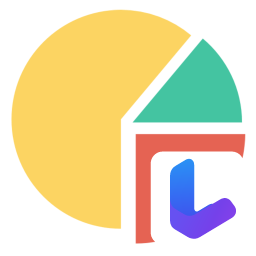

<p align="center">
  
</p>

# Lengko.Chart.WinForms — Demos & Samples

Interactive sample showcase for **Lengko.Chart.WinForms**, featuring 25+ high-performance chart controls rendered with pure GDI+ vector graphics in Windows Forms.

[]()
[]()
[]()
[](LICENSE.txt)

---

## Projects in this Folder

| Language | Project File | Description |
|---|---|---|
| **C#** | `CSharp/Lengko.Chart.Demo.CSharp.csproj` | Comprehensive C# WinForms demo with live chart switching, dark/light themes, and real-time data generators. |
| **VB.NET** | `VB/Lengko.Chart.Demo.VB.vbproj` | Full-featured VB.NET WinForms demo showing all chart types and custom styling. |
| **F#** | `FSharp/Lengko.Chart.Demo.FSharp.fsproj` | Functional F# WinForms demo with immutable data pipelines and chart rendering. |

Dedicated solution: **`Lengko.Chart.WinForms.sln`** (builds all 3 demos alongside the library).

---

## Quick Start / How to Run

### Via Visual Studio
Open `Lengko.Chart.WinForms.sln`, select any demo project as the Startup Project, and press `F5`.

### Via .NET CLI

```powershell
# Run C# Demo
dotnet run --project CSharp/Lengko.Chart.Demo.CSharp.csproj

# Run VB.NET Demo
dotnet run --project VB/Lengko.Chart.Demo.VB.vbproj

# Run F# Demo
dotnet run --project FSharp/Lengko.Chart.Demo.FSharp.fsproj
```

---

## Code Examples

### C#
```csharp
using System.Drawing;
using System.Windows.Forms;
using Lengko.Chart.WinForms;

var chart = new LengkoBarChart
{
    Dock = DockStyle.Fill,
    BackColor = Color.FromArgb(24, 24, 27),
    ShowGrid = true,
    ShowValues = true
};

chart.Categories.AddRange(new[] { "Jan", "Feb", "Mar", "Apr", "May" });
chart.Series.Add(new LengkoBarSeries("Revenue", new double[] { 120, 150, 180, 220, 260 }, Color.FromArgb(59, 130, 246)));
chart.Series.Add(new LengkoBarSeries("Profit", new double[] { 45, 60, 75, 95, 120 }, Color.FromArgb(16, 185, 129)));

this.Controls.Add(chart);
```

### VB.NET
```vb
Imports System.Drawing
Imports System.Windows.Forms
Imports Lengko.Chart.WinForms

Dim chart As New LengkoBarChart With {
    .Dock = DockStyle.Fill,
    .BackColor = Color.FromArgb(24, 24, 27),
    .ShowGrid = True,
    .ShowValues = True
}

chart.Categories.AddRange({"Jan", "Feb", "Mar", "Apr", "May"})
chart.Series.Add(New LengkoBarSeries("Revenue", {120.0, 150.0, 180.0, 220.0, 260.0}, Color.FromArgb(59, 130, 246)))
chart.Series.Add(New LengkoBarSeries("Profit", {45.0, 60.0, 75.0, 95.0, 120.0}, Color.FromArgb(16, 185, 129)))

Me.Controls.Add(chart)
```

### F#
```fsharp
open System.Drawing
open System.Windows.Forms
open Lengko.Chart.WinForms

let chart = new LengkoBarChart(Dock = DockStyle.Fill, BackColor = Color.FromArgb(24, 24, 27), ShowGrid = true, ShowValues = true)
chart.Categories.AddRange([| "Jan"; "Feb"; "Mar"; "Apr"; "May" |])
chart.Series.Add(new LengkoBarSeries("Revenue", [| 120.0; 150.0; 180.0; 220.0; 260.0 |], Color.FromArgb(59, 130, 246)))
chart.Series.Add(new LengkoBarSeries("Profit", [| 45.0; 60.0; 75.0; 95.0; 120.0 |], Color.FromArgb(16, 185, 129)))

form.Controls.Add(chart)
```


---

## Featured Chart Types

- **Categorical**: `LengkoBarChart`, `LengkoHorizontalBarChart`, `LengkoStackedBarChart`
- **Trends & Continuous**: `LengkoLineChart`, `LengkoAreaChart`, `LengkoStackedAreaChart`, `LengkoStepLineChart`
- **Proportional**: `LengkoPieChart` (Pie & Donut), `LengkoFunnelChart`, `LengkoPyramidChart`
- **Financial & Trading**: `LengkoCandlestickChart`, `LengkoOhlcChart`
- **Distribution & Statistical**: `LengkoScatterChart`, `LengkoBubbleChart`, `LengkoBoxPlotChart`, `LengkoHistogramChart`, `LengkoParetoChart`
- **Multivariate**: `LengkoRadarChart`, `LengkoPolarAreaChart`, `LengkoHeatmapChart`
- **Management & Flow**: `LengkoGanttChart`, `LengkoWaterfallChart`, `LengkoBulletGraph`, `LengkoRadialGauge`, `LengkoSparkline`

---

## License
Proprietary Freeware License (PFL). Free for personal, educational, and commercial use. See [LICENSE.txt](LICENSE.txt).
